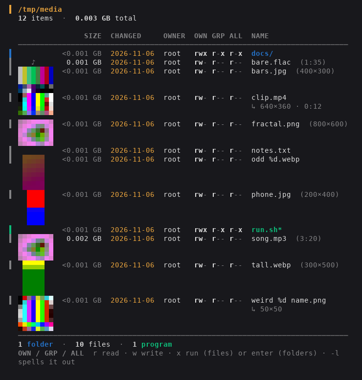

# lx

A plain-language evolution of `ls -l` with real folder sizes, thumbnails of your pictures, videos and music, and a TreeSize-style space map. One static binary, Go standard library only, runs on any Linux distribution.



`lx -l` is the full view, with permissions spelled out in words and no pictures:

```
$ lx -l
/home/kyle  ·  14 items  ·  412.61 GB total  ·  23 hidden (show with -a)
 KIND           SIZE  LAST CHANGED      OWNER  GROUP  OWNER CAN         GROUP CAN         EVERYONE CAN      NAME
 folder    306.12 GB  2026-10-30 14:02  kyle   kyle   read write enter  read ·     enter  ·    ·     ·      Games/
 folder      2.41 GB  2026-10-29 09:13  kyle   kyle   read write enter  read ·     enter  read ·     enter  Documents/
 link              —  2026-07-12 18:40  kyle   kyle   read write enter  read ·     enter  read ·     enter  scripts → /srv/scripts/
 program   <0.001 GB  2026-10-01 11:20  kyle   kyle   read write run    read ·     run    read ·     run    backup.sh*
 file        0.004 GB  2026-10-28 22:10  kyle   kyle   read write ·      read write ·      read write ·      notes.txt  (anyone can change this)
```

## Install

`lx` is a single self-contained file. Installing it just means copying it onto your PATH:

```bash
sudo install -m 755 lx /usr/local/bin/lx     # uninstall: sudo rm /usr/local/bin/lx
```

Prebuilt copies live in `dist/<arch>/lx`. Use `amd64` for ordinary Intel/AMD PCs (`uname -m` says `x86_64`), and `arm64` for a Raspberry Pi 4/5 or ARM server (`aarch64`). Also built: `386`, `arm`, `riscv64`, `ppc64le`, `s390x`.

Build from source (Go 1.22+):

```bash
./build.sh            # every architecture into dist/<arch>/lx
go build -o lx .      # just this machine
```

## Listing

Same information as `ls -l`, said plainly. The default view puts a thumbnail beside every picture, video and song, and collapses permissions into one `OWN GRP ALL` column (`rwx r-x r--`, with a legend under the table). `-l` gives the full view: three permission columns in words, and no thumbnails.

| Column | Meaning |
|---|---|
| KIND | `folder`, `file`, `program` (executable), `link`, `broken link`, `device`, `pipe`, `socket` |
| SIZE | GB by default. **Folder sizes include everything inside them.** `≥` = minimum (something inside was unreadable); `?` = you can't open it at all |
| LAST CHANGED | modification time, highlighted if within the last day |
| OWNER / GROUP | names, not numbers |
| OWN GRP ALL | default view: `r` read, `w` write, `x` run (files) or enter (folders), for the owner, the group, and everyone else; `-` = not allowed |
| OWNER / GROUP / EVERYONE CAN | `-l` view: `read`, `write`, `run` / `enter` as words, always in the same position so they scan down the column; `·` = not allowed |
| NAME | colored by kind; `name/` folder, `name*` program, `name → target` link. Media files add their dimensions and running time: `(1920×1080 · 4:32)` |

Anything unusual gets a short note after the name: setuid/setgid ("runs as root no matter who starts it"), sticky folders, world-writable items, hard link counts, ACLs, device numbers, unreadable items, and mounts that weren't counted.

### Fitting the terminal

The listing never runs past the right edge. As the terminal narrows it steps down.

Default view:

| Step | What changes |
|---|---|
| 1 | full table with thumbnails |
| 2 | date only (`2026-10-30`) |
| 3 | OWNER and GROUP merged into `OWNER:GROUP` |
| 4 | group name dropped (a footnote appears if any group differs from its owner) |
| 5 | KIND column dropped (names, the gutter and `/` `*` suffixes still show kind) |
| 6 | thumbnails dropped, steps 1–5 again |
| 7 | one card per item, for very narrow terminals |

With `-l`, keeping the permission words as long as it can:

| Step | What changes |
|---|---|
| 1 | full table |
| 2 | date only |
| 3 | `OWNER:GROUP` merged |
| 4 | group name dropped |
| 5 | permissions become `rwx` letters, with a legend under the table |
| 6 | one card per item |

Long names and notes wrap under the NAME column with a hanging indent, breaking at `/ - _ . space` where possible and never leaving a stub like `zst` alone on a line. Notes sit after the name when they fit and drop to their own `↳` line when they don't. Japanese, Chinese, Korean and emoji are measured at their true two-cell width, so columns stay straight. With `-l`, `--wide` skips the letters step (it goes straight to cards instead).

Piped output is never wrapped, one line per item, and has no thumbnails. Use `--width N` to lay it out for a pager: `lx --color=always --thumbs --width 120 | less -R`.

ls habits work: `-a`, `-S` (size), `-t` (time), `-r`, `-h` (pick a unit per item), and `-l` for the long view.

## Thumbnails

Pictures, videos, songs with album art, and anything your file manager has already made a preview of (PDFs, documents, fonts…) get a small picture beside their row.

**How they're drawn.** lx asks the terminal what it can do rather than guessing from `$TERM`:

| Mode | Terminals | Looks |
|---|---|---|
| `kitty` | kitty, WezTerm, Ghostty, Konsole | real pixels, full color |
| `sixel` | foot, Konsole, mlterm, Windows Terminal, contour, `xterm -ti vt340` | real pixels, 256 colors |
| `blocks` | any color terminal, including over ssh, inside tmux/screen, and in `less -R` | colored `▀` half-blocks, two pixels per character |

Force one with `--graphics kitty|sixel|blocks`. Inside tmux or screen, auto picks `blocks`, since multiplexers swallow image protocols unless specially set up.

**Where previews come from**, cheapest first:

1. **Your file manager's thumbnail cache** (`~/.cache/thumbnails`, shared by Dolphin, Nautilus, Thunar, etc.), only when the cached preview's recorded modification time matches the file, so stale previews never show.
2. **Go's own decoders** for PNG, JPEG and GIF. Phone photos are turned the right way up using their EXIF orientation.
3. **ffmpeg**, if installed, for video (a frame a tenth of the way in, past black intros and logos), album art, and WebP, HEIC, AVIF, TIFF, BMP and the rest. Without it those files get a placeholder (`▶` `♪` `▣`) and a footnote saying ffmpeg would show them.

| Flag | Default | |
|---|---|---|
| `--thumb-size N` | 8 | thumbnail width in character cells (height follows) |
| `--graphics G` | auto | `auto`, `kitty`, `sixel` or `blocks` |
| `--no-thumbs` | | text only (`-l` also has none) |
| `--thumbs` | | show them even when piped |

Previews are made in parallel (a progress counter appears on stderr for big folders). Pictures claiming more than 80 megapixels aren't decoded in memory (decompression-bomb protection); ffmpeg gets a try at those instead.

## Space map: `-T`

```
$ lx -T ~
Space used under /home/kyle  ·  412.61 GB  ·  1,204,551 items
       SIZE   SHARE  OF ITS FOLDER         NAME
  412.61 GB  100.0%  ████████████████████  /home/kyle/
  306.12 GB   74.2%  ██████████████▊░░░░░  ├─ Games/
  211.40 GB   69.1%  █████████████▊░░░░░░  │  ├─ SteamLibrary/
  ...
    1.20 GB    0.3%  ▏░░░░░░░░░░░░░░░░░░░  └─ … 37 smaller items
```

The space map fits the terminal too: bars shrink (24 → 20 → 12 → 8 cells) and disappear below 56 columns, the SHARE column goes below 46, and long names are shortened in the middle (`2026-10-28_proxmox…template.vma.zst`) so the tree lines never break.

Each folder's biggest items, ranked, with a bar showing their share of the folder they're in. Hidden items are always included here.

| Flag | Default | |
|---|---|---|
| `-L N`, `--depth N` | 3 | levels to show |
| `--top N` | 10 | most items shown per folder |
| `--min PCT` | 1 | fold anything under PCT% of the total into "smaller items" |

## Measuring

- Hard-linked files are counted once (like `du`); links are never followed.
- `/proc`, `/sys`, cgroup, debugfs and other kernel filesystems are never counted.
- `-x` / `--one-fs` skips other drives mounted inside the path (note: on btrfs this also skips subvolumes, same as `du -x`).
- `--disk` reports space allocated on disk instead of file length (sparse files, compression).
- `--no-size` skips folder measurement entirely for instant listings.
- 1 GB = 1024³ bytes, matching `ls -h`, `du -h` and most file managers.
- Folders are measured in parallel; a live item counter appears on stderr for slow scans.

## Safety

Filenames containing control characters are escaped (`\x1b`, `\n`) so a hostile name can't inject terminal escape sequences or fake extra lines. The tool only reads; it never writes anything, including to the thumbnail cache.

Thumbnails mean parsing file contents, which plain listings never did. Go's decoders are memory-safe. ffmpeg is not, so it's started with the least it needs:

- `-protocol_whitelist file`: a playlist, `.m3u8` or `.concat` file can't make it reach the network or other protocols
- the path is passed as `file:/absolute/path`, so names like `concat:…` or `http:…` are never read as instructions; `%` in image names isn't expanded into a numbered sequence
- no stdin, stderr discarded, 20-second timeout, output capped

Use `--no-thumbs` (or `-l`) in folders of files you don't trust.

## Exit codes

`0` success · `2` a path couldn't be read or a bad option was given.
